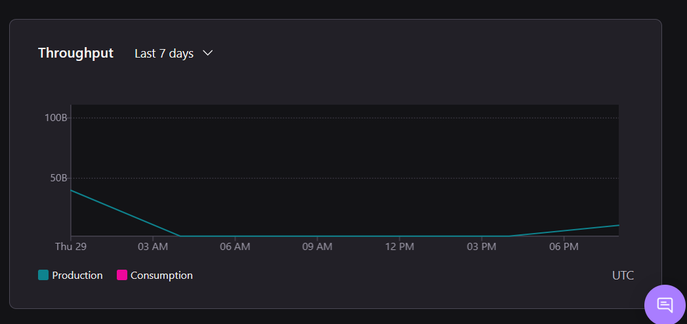
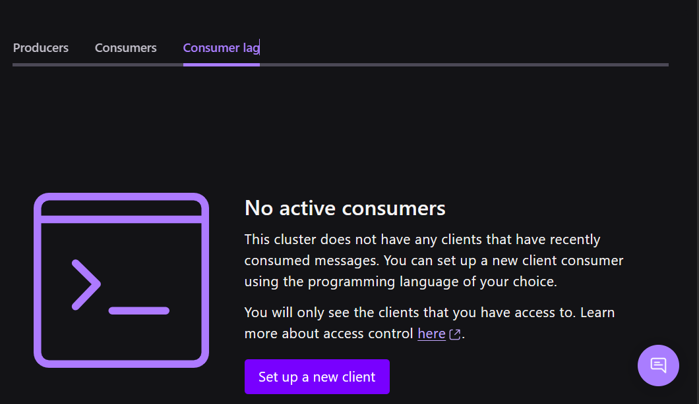
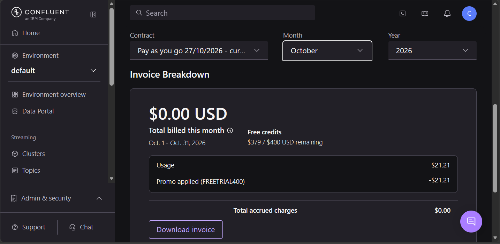

# Pipeline de Dados em Tempo Real para Agentes de IA

Projeto desenvolvido no bootcamp **IBM Confluent - Dados em tempo real para agentes de IA** (DIO), como Desafio Final que evolui módulo a módulo.

## Objetivo

Construir um pipeline de dados end-to-end em tempo real, usando **Confluent Cloud (Kafka)** como espinha dorsal, capturando mudanças de sistemas existentes via CDC, processando o fluxo com Flink e materializando os dados como tabelas Iceberg, como base para RAG e agentes de IA. Nesta entrega o pipeline vai até o Iceberg; a camada de IA (inferência, embeddings, agentes) não foi implementada e está em "Próximos passos".

O caso de uso do desafio é um **pipeline de pagamentos**: Postgres (Neon) → CDC (Debezium) → tópicos Avro + Schema Registry → Flink SQL (enriquecimento + regra de fraude) → consumo. Os dados são sintéticos (seed determinístico, `seed=42`).

## Stack

| Camada | Tecnologia |
|---|---|
| Banco de origem | PostgreSQL (Neon) |
| Streaming / Event Log | Apache Kafka (Confluent Cloud) |
| Governança de contratos | Schema Registry |
| Integração / CDC | Kafka Connect + Debezium |
| Processamento de stream | Apache Flink / Flink SQL |
| Lakehouse | Tableflow → Apache Iceberg |

## Estrutura do repositório

| Pasta / arquivo | Camada | Conteúdo |
|---|---|---|
| `kafka/schemas/` | 2 Contrato | schema Avro atual de `customers` e as variantes usadas nos testes de compatibilidade (a fundação da camada 1 é criada pelo `setup.sh`) |
| `cdc-debezium/` | 3 Ingestão | `cdc.json` (conector, sem segredos), `seed/` (dados sintéticos) e `seed/apply_tags.sh` (tags PII/PCI por campo, via API do catálogo) |
| `flink-sql/` | 4 Processamento | statements SQL: enriquecimento e regra de fraude |
| `tableflow-iceberg/` | Extensão | `query_iceberg.py`: consulta as tabelas Iceberg pelo catálogo REST |
| `scripts/` | 5 Operação | `metrics.sh`: consulta à Metrics API |
| `evidencias/` | todas | saídas de comandos e eventos que provam cada camada; `rodada2/` traz as da segunda subida (envelopes completos, tags, enriquecimento, teardown) |
| `setup.sh` / `teardown.sh` | todas | subir e derrubar o pipeline |

## Status

✅ Entregue em 31/10/2026 (inscrições até 18/10, entrega até 15/11/2026). A infraestrutura já foi derrubada (`teardown.sh`); o repositório guarda as evidências.

- [x] Módulo 1: Kafka (chave por PK preserva ordem; entrega *at-least-once*; 1 partição)
- [x] Módulo 2: Confluent Cloud (environment, cluster Basic, service accounts, ACLs, Schema Registry)
- [x] Módulo 3: Kafka Connect + CDC com Debezium (sink connectors e dead letter topic **não** feitos)
- [x] Módulo 4: Flink SQL (conversão para append-only, watermark, `MATCH_RECOGNIZE`; join de enriquecimento transação × conta entregue na rodada 2)
- [x] Módulo 5: Tableflow (tópicos Kafka → tabelas Apache Iceberg)
- [x] Desafio Final consolidado (custo: US$ 21,21, coberto pelo crédito promocional; ver "Custo total e teardown")
- [x] **Rodada 2 (02/11/2026)**: fechei as lacunas da primeira entrega com uma segunda subida curta da infraestrutura: join de enriquecimento, tags PII/PCI por campo, envelope `op=u` completo e tombstone, e reexecução real do `setup.sh` (fundação e ingestão). Evidências em `evidencias/rodada2/`.

## Como subir do zero

Pré-requisitos: conta no Confluent Cloud, projeto no Neon, [Confluent CLI](https://docs.confluent.io/confluent-cli/current/overview.html), `psql`, `envsubst`, `python3`.

```bash
cp .env.example .env     # preencha os valores; o .env NUNCA é versionado
./setup.sh fundacao      # confira a evidência antes de avançar
./setup.sh ingestao
./setup.sh contrato      # depois da ingestão: os schemas são registrados pelo conector
./setup.sh processamento
./setup.sh operacao
```

**Estado de validação, com honestidade:** na rodada 2 reexecutei o `setup.sh` do zero para a **fundação** (`./setup.sh fundacao`, `evidencias/rodada2/01-fundacao.txt`) e a **ingestão** (`./setup.sh ingestao`: carga do seed, publication e conector, `evidencias/rodada2/03-conector.txt`); ambas funcionaram na primeira tentativa. As funções `contrato` e `processamento` **não** foram reexecutadas via script: o contrato foi validado na primeira rodada e, na segunda, os statements Flink foram rodados à mão no workspace do console. O `teardown.sh` foi executado nas duas rodadas (`evidencias/07-teardown.txt` e `evidencias/rodada2/07-teardown.txt`). Dois passos são manuais: habilitar a replicação lógica e criar o `cdc_user` no Neon (console), e rodar os arquivos de `flink-sql/` no shell do Flink. Dentro do script, os trechos marcados `[não testado]` vêm da documentação e devem ser conferidos antes de confiar.

## Como derrubar tudo

```bash
./teardown.sh
```

Para os statements Flink, remove os conectores, apaga o replication slot no Postgres e deleta o environment.

---

## Camada 1: Fundação (`kafka/`)

**O que faz:**

- Environment `desafio-final` (`env-o7mj39`), com Stream Governance Essentials, isolado do environment `default`.
- Cluster Kafka **Basic** `desafio-basic` (`lkc-dozgd01`) em `aws/us-east-1`, single-zone.
- Duas identidades (service accounts), uma por papel, com uma chave de API cada:
  - `desafio-producer` (`sa-v1y03yn`): `WRITE`, `DESCRIBE` e `CREATE` nos tópicos com prefixo `desafio`.
  - `desafio-consumer` (`sa-gkx8gjn`): `READ` e `DESCRIBE` nos tópicos `desafio*` e `READ` nos grupos de consumo `desafio*`.

**Por que assim:**

- **Duas identidades, menor privilégio:** quem escreve não lê e quem lê não escreve. Se a chave do consumer vazar, ela não consegue gravar no tópico.
- **ACL por prefixo (`desafio`):** limita o alcance aos tópicos do projeto, incluindo os que o conector CDC vai criar. Em produção, o RBAC é o padrão e a ACL é a exceção documentada (Aula 3); aqui a ACL por prefixo segue o desenho do desafio.
- **Cluster Basic:** é o tipo certo para dev e POC (Aula 2) e só cobra pelo uso. O volume do desafio (cerca de 2.000 transações sintéticas) cabe com folga. Em produção, o trade-off seria Standard ou superior, por SLA e rede privada.
- **Environment dedicado:** dá uma fronteira de isolamento e permite derrubar tudo com um único `delete` no teardown.

**Evidência** (`evidencias/01-fundacao.txt`: `service-account list`, `acl list` de cada identidade e `api-key list`; os secrets nunca aparecem):

```text
  Current |     ID     |       Name       |          Description           
----------+------------+------------------+--------------------------------
          | sa-gkx8gjn | desafio-consumer | le os topicos desafio-*        
          | sa-v1y03yn | desafio-producer | escreve nos topicos desafio-*  
     Principal    | Permission | Operation | Resource Type | Resource Name | Pattern Type  
------------------+------------+-----------+---------------+---------------+---------------
  User:sa-v1y03yn | ALLOW      | CREATE    | TOPIC         | desafio       | PREFIXED      
  User:sa-v1y03yn | ALLOW      | DESCRIBE  | TOPIC         | desafio       | PREFIXED      
  User:sa-v1y03yn | ALLOW      | WRITE     | TOPIC         | desafio       | PREFIXED      
     Principal    | Permission | Operation | Resource Type | Resource Name | Pattern Type  
------------------+------------+-----------+---------------+---------------+---------------
  User:sa-gkx8gjn | ALLOW      | DESCRIBE  | TOPIC         | desafio       | PREFIXED      
  User:sa-gkx8gjn | ALLOW      | READ      | GROUP         | desafio       | PREFIXED      
  User:sa-gkx8gjn | ALLOW      | READ      | TOPIC         | desafio       | PREFIXED      
  Current |       Key        |   Description    |   Owner    |    Owner Email    | Resource Type |  Resource   |       Created         
----------+------------------+------------------+------------+-------------------+---------------+-------------+-----------------------
          | OT4XULKQTJXJI642 | desafio-producer | sa-v1y03yn | <service account> | kafka         | lkc-dozgd01 | 2026-10-28T22:30:07Z  
          | UDONLAMX2PE5ECZA | desafio-consumer | sa-gkx8gjn | <service account> | kafka         | lkc-dozgd01 | 2026-10-28T22:34:01Z  
```

## Camada 2: Contrato de dados (`kafka/schemas/`)

**O que faz:** O Debezium registra automaticamente um schema Avro por tabela no Schema Registry (subjects `desafio.public.<tabela>-value`, envelope com `before`/`after`/`source`/`op`). Esses schemas são o contrato do pipeline (namespace `desafio.public.<tabela>` gerado pelo conector, não um namespace próprio; `amount` aparece como `bytes` com `decimal(15,2)` no Avro). **Tags de PII/PCI (rodada 2):** os campos sensíveis foram classificados no catálogo do Stream Governance, por campo: `PII` em `customers.full_name`, `email` e `phone`, e `PCI` em `cards.last4`. Fiz pela API do catálogo (`cdc-debezium/seed/apply_tags.sh`, entidade `sr_field`, nome `<sr-id>:.:<schema-id>:desafio.public.<tabela>.Value.<campo>`), porque a aba Schema do console só oferecia tag no nível do schema ou do topic. A resposta da API, com as 4 tags `ACTIVE`, está em `evidencias/rodada2/04-tags.txt`. A tag vale para `before` e `after`, que usam o mesmo record `Value`. Em `kafka/schemas/` ficam o schema atual de `customers` e três variantes usadas nos testes de evolução.

**Por que assim:** Mantive a compatibilidade `BACKWARD` (padrão do Schema Registry): o consumidor novo lê dados antigos, então os consumidores (Flink, Tableflow) podem ser atualizados antes do produtor. Nessa regra, adicionar campo opcional com `default` é seguro; adicionar campo obrigatório sem `default` quebra, porque o consumidor novo não saberia preencher o campo nos dados antigos. Remover campo é aceito em `BACKWARD` (o consumidor novo ignora o que sumiu); para barrar remoções seria preciso `FORWARD` ou `FULL`, trade-off que registrei na tabela de decisões. Os testes usam `validate`, que não registra versão e não suja o subject.

**Evidência** (`evidencias/02-compatibilidade.txt`, subject `desafio.public.customers-value`, versão 1):

```text
=== add-optional ===      Compatible | true    (campo novo opcional, default null)
=== add-required ===      Compatible | false   (campo novo obrigatório, sem default)
=== remove-required ===   Compatible | true    (remoção de `email`: aceita em BACKWARD)
```

## Camada 3: Ingestão CDC (`cdc-debezium/`)

**O que faz:** Conector gerenciado `PostgresCdcSourceV2` (Debezium 3.2.5) lê o WAL do Postgres (Neon) com o usuário `cdc_user` (permissão mínima de replicação) e publica as 5 tabelas (`customers`, `accounts`, `cards`, `merchants`, `transactions`) em tópicos `desafio.public.<tabela>`, em Avro, com a chave primária como chave Kafka. (config em `cdc-debezium/cdc.json`, sem segredos).

**Por que assim:** CDC lê o log de transações, então captura INSERT, UPDATE e DELETE com baixa latência e sem consultar as tabelas; polling perderia DELETEs e estados intermediários. Usei `REPLICA IDENTITY FULL` para que `before` venha completo em UPDATE/DELETE (custo: mais bytes no WAL). Cada tópico tem 1 partição (padrão do conector), o que preserva a ordem global, mas limita o paralelismo. Lição de menor privilégio: o conector também precisou de ACL (CREATE/DESCRIBE/WRITE) no prefixo `__debezium-heartbeat`; sem ela ficou `FAILED` por falta de autorização.

**Evidência:**

```text
Seed determinístico (`seed=42`) carregado no Postgres 18 do Neon (`cdc-debezium/seed/load.sh`):

 customers | accounts | cards | merchants | transactions 
-----------+----------+-------+-----------+--------------
       200 |      240 |   320 |        60 |         2000
(1 row)
```

Eventos capturados na rodada 2, completos e conferidos contra o JSON baixado do console (`evidencias/rodada2/03-envelopes-cdc.json`; a captura da primeira rodada, `evidencias/03-envelopes-cdc.json`, tinha o `op=u` truncado):

- `op=c` (INSERT): `before: null`, `after` com `city = Curitiba` (offset 200)
- `op=u` (UPDATE): `before` com `Curitiba` / `11999990000` e `after` com `Florianópolis` / `48988880000` (offset 201)
- `op=d` (DELETE): `before` completo, `after: null` (offset 202); a mesma chave `customer_id=201` nos 3 eventos preserva a ordem na partição
- **tombstone** (offset 203): mesma chave, valor `null`, emitido logo depois do `op=d`; é ele que permite à compactação de log remover a chave
- `op=r` (snapshot): offsets 0 a 199, com `source.snapshot = true` e `last_in_data_collection` no último; no `transactions`, a última mensagem do snapshot inteiro traz `snapshot = last`

O `before` completo no `op=u` e no `op=d` comprova o `REPLICA IDENTITY FULL`. A captura da primeira rodada (`evidencias/03-envelopes-cdc.json`) usou outros valores (`Nova Prata` → `Caxias do Sul`).

## Camada 4: Processamento (`flink-sql/`)

**Escopo entregue:** conversão para append-only, regra de fraude e, na rodada 2, o **enriquecimento transação × conta** (join com `accounts`).

**O que faz:** Três statements Flink SQL contínuos num compute pool de até 5 CFU (os dois primeiros na rodada 1, o terceiro na rodada 2). (1) `tx-stream-insert` converte `desafio.public.transactions` (changelog `retract` do Debezium) numa tabela append-only `tx_stream`, com `created_at` convertido para `TIMESTAMP(3)` e watermark. (2) `fraud-detect` aplica um `MATCH_RECOGNIZE` particionado por cartão e grava em `fraud_alerts` quando há 3 transações do mesmo cartão em até 60 s (`PATTERN (T{3}) WITHIN INTERVAL '60' SECOND`). (3) `tx-enrich` (rodada 2) faz o join com `accounts` e grava em `tx_enriched`. Statements em `flink-sql/01..06_*.sql`.

**Por que assim:**
- `MATCH_RECOGNIZE` não aceita entrada que atualiza ou apaga linhas, então a tabela do Debezium passa por `TO_CHANGELOG` (só inserts; transações são imutáveis) antes da regra.
- O tempo da regra é o tempo do evento (`created_at`), não o de chegada, para que atrasos do pipeline não mudem o resultado.
- Watermark com folga de 1 ms: o aviso `WATERMARK_EQUAL` do Flink mostrou que, sem folga, eventos com o mesmo `ts` contam como atrasados. Folga maior atrasaria o alerta; folga menor perderia eventos. Evento muito fora de ordem continua sendo ignorado.
- Como o `MATCH_RECOGNIZE` só libera uma linha quando o watermark a ultrapassa e a tabela tem pouco tráfego, o alerta depende de um evento posterior de qualquer cartão. Em produção o fluxo contínuo resolve isso; no teste uso uma transação de outro cartão.
- `AFTER MATCH SKIP PAST LAST ROW`: uma rajada gera um alerta, não vários sobrepostos.
- **Enriquecimento (rodada 2):** `tx_enriched` é o join de `tx_stream` com `desafio.public.accounts` por `account_id` (`flink-sql/05_*` e `06_*`), em modo upsert com chave `transaction_id`. Escolhi o **join comum** e não o temporal: o temporal (`FOR SYSTEM_TIME AS OF`) exigiria versões de `accounts` anteriores ao `ts` da transação, e as contas só têm versão a partir do snapshot, enquanto as transações do seed são de setembro (hipótese que não cheguei a testar; escolhi o caminho seguro). O topic de saída `tx_enriched` chegou a pelo menos 2000 mensagens (offsets até 1999), e cada uma traz `customer_id`, `account_type`, `account_status` e `balance` que não existem em `transactions` (`evidencias/rodada2/05-tx-enriched-amostra.json` e `05-tx-enriched-offset1991.json`). O join é por `account_id`, e não por `card_id`, porque a conta do cartão pode ser diferente (cartão 234 pertence à conta 234, cujo cliente é o 193).
- **Trade-offs do join, avisos reais do Flink:** `UPSERT_AND_PRIMARY_KEYS_DIFFERENT` (o Flink não derivou a chave de upsert do join e pode inserir um operador de correção que consome estado) e `HIGH_STATE_OPERATOR_WITHOUT_TTL` (o join comum guarda estado sem TTL; em produção eu definiria `sql.state-ttl`, como está no `06_tx_enrich.sql`, mas na execução da rodada 2 rodei sem ele, por ser uma carga curta). Um `COUNT(*)` sem `GROUP BY` que usei para conferir o resultado também gerou `AGGREGATION_WITHOUT_KEY`, inofensivo numa conferência única.
- Os dados sintéticos têm transações `APPROVED` em contas `BLOCKED` (por exemplo, a transação 871); o enriquecimento torna possível uma segunda regra a partir delas.

**Evidência** (`evidencias/04-fraude.txt`):

```text
Antes da rajada: fraud_alerts vazia (nenhum falso positivo nas 2000 transações do seed)

transaction_id | card_id | amount | ts
2001           | 1       | 100.00 | 2026-10-29 22:59:02.958
2002           | 1       | 101.00 | 2026-10-29 22:59:12.958
2003           | 1       | 102.00 | 2026-10-29 22:59:22.958

Alerta em fraud_alerts:
card_id | first_ts                | last_ts                 | tx_count | total_amount | first_tx_id | last_tx_id
1       | 2026-10-29 22:59:02.958 | 2026-10-29 22:59:22.958 | 3        | 303.00       | 2001        | 2003
```

## Camada 5: Operação

| Pilar | Resposta (medida) |
|---|---|
| Observabilidade | Metrics API (`scripts/metrics.sh`, resumo em `evidencias/05-metricas-resumo.txt`): pico de `received_bytes` de **492.200 bytes em 1 minuto** (29/10 00:19 UTC = 28/10 21:19 em Brasília), no snapshot inicial do conector; 396.094 bytes só do tópico `desafio.public.transactions`. Total produzido de 28/10 a 29/10: **819.509 bytes**. **Lag por grupo: nenhum grupo de consumidores ativo** (`evidencias/05-consumer-lag.png`), porque o Flink lê por dentro da plataforma e não há consumidor externo. |
| Segurança | Tabela abaixo. Duas service accounts com ACLs por prefixo `desafio`, sem permissão em outros tópicos. |
| Custos | US$ 21,21 no total (ver "Custo total e teardown"); **o conector é 96,6% do custo** (US$ 20,50: cobra US$ 0,50 por task-hora, ligado ou não ao tráfego, por cerca de 41 h); o cluster Basic custou US$ 0,27. Alavancas medidas: (1) **ligar o conector só pelo tempo necessário**: parar ou apagar logo depois do snapshot e dos eventos de teste, já que o volume (~820 KB) não justifica horas de task; (2) **parar os statements Flink e o Tableflow** assim que a evidência é salva (Flink US$ 0,14 com teto de 5 CFU; Tableflow US$ 0,10 por tópico-hora). |
| Confiabilidade | Tabela abaixo; elo mais fraco: o conector com `tasks.max=1` e o slot de replicação no Postgres. |

**Prints do console (Confluent Cloud, cluster `desafio-basic`)**

| Throughput (últimos 7 dias) | Consumer lag |
|---|---|
|  |  |

O gráfico do console agrega os valores em intervalos largos e por isso mostra picos de poucas dezenas de bytes; o valor exato por minuto vem da Metrics API (`evidencias/05-metricas-resumo.txt`), citado na tabela acima.

**Segurança: service account → ACLs → porquê**

| Service account | ACLs (prefixo `desafio`, salvo indicado) | Por quê |
|---|---|---|
| `desafio-producer` (`sa-v1y03yn`) | `CREATE`, `DESCRIBE`, `WRITE` em tópicos `desafio*`; os mesmos três em `__debezium-heartbeat*` | É a identidade do conector CDC: só escreve. A ACL do heartbeat foi descoberta quando o conector ficou `FAILED` ("not authorized to access the designated topic"): o Debezium grava um tópico de batimento fora do prefixo do projeto. Corrigi com a menor ACL possível em vez de dar permissão ampla. |
| `desafio-consumer` (`sa-gkx8gjn`) | `DESCRIBE` e `READ` em tópicos `desafio*`; `READ` em grupos `desafio*` | Identidade só de leitura para consumidores. Hoje ninguém a usa (o Flink roda com o usuário da conta); fica pronta para um consumidor externo ou um sink connector. |

Limitação: os statements Flink rodam com o usuário pessoal, e o RBAC é o padrão recomendado em produção (Aula 3). Aqui usei ACLs por prefixo, que são mais simples para um ambiente com dois papéis. Evidência: `evidencias/01-fundacao.txt`.

**Confiabilidade: trecho a trecho**

| Trecho | Garantia / risco | Mitigação |
|---|---|---|
| Postgres (Neon) → conector | Conector com `tasks.max=1`; o slot de replicação retém WAL se o conector parar (slot órfão enche o disco); no plano Free o compute pode suspender | `heartbeat.interval.ms=60000`; o teardown apaga o slot |
| Conector → Kafka | Entrega *at-least-once*: após reinício o mesmo evento pode chegar duplicado | Chave = chave primária; consumidores devem ser idempotentes |
| Tópicos | 1 partição por tópico: ordem garantida por chave, sem paralelismo; cluster Basic é de zona única | Volume do projeto é pequeno (~820 KB) |
| Schema Registry | `BACKWARD`: campo obrigatório sem default é barrado na entrada | Testes em `evidencias/02-compatibilidade.txt` |
| Consumidor → efeito | Não há consumidor neste projeto; em um consumidor real, a idempotência é código do consumidor (o conector entrega *at-least-once*) | Chave = PK permite deduplicar |
| Flink | O alerta depende do watermark (precisa de evento posterior); evento muito fora de ordem é ignorado | Watermark de 1 ms; em produção o fluxo contínuo avança o watermark |

## Extensão: Tableflow + Iceberg (`tableflow-iceberg/`)

**O que foi feito:** O Tableflow materializou os tópicos `tx_stream` (2004 transações) e `fraud_alerts` (o alerta de fraude) como tabelas **Apache Iceberg**, com armazenamento gerenciado pela Confluent e catálogo **Confluent REST**. O script `tableflow-iceberg/query_iceberg.py` consulta as tabelas com `pyiceberg` pelo catálogo REST, sem copiar dados.

**Por que assim:** O Tableflow não materializa direto os tópicos do Debezium: o formato de envelope (`avro-debezium-registry`) não é aceito nos modos append e upsert, e a alternativa seria reconfigurar o conector (`after.state.only=true`) ou decodificar o envelope no Flink, mexendo num pipeline já validado. Por isso materializei a **saída do Flink**, em Avro comum e append-only, fechando a trilha Debezium → Flink → Tableflow → Iceberg. Trade-off: as tabelas Iceberg trazem o dado já enriquecido pelo Flink, e não um espelho das tabelas do Postgres.

**Evidência** (`evidencias/06-iceberg.txt`):

```text
Namespace (cluster): lkc-dozgd01
Tabelas: ['tx_stream', 'fraud_alerts']

== fraud_alerts ==  Linhas: 1  Snapshots: 3
card_id:long, first_ts:timestamp, last_ts:timestamp, tx_count:long, total_amount:decimal(15, 2), first_tx_id:long, last_tx_id:long
card_id=1  first_ts=2026-10-29 22:59:02.958  last_ts=2026-10-29 22:59:22.958  tx_count=3  total_amount=303.00  first_tx_id=2001  last_tx_id=2003

== tx_stream ==  Linhas: 2004  Snapshots: 3
card_id:long, transaction_id:long, account_id:long, merchant_id:long, amount:decimal(15, 2), currency:string, status:string, ts:timestamp
```

Observações: `DECIMAL(15,2)` e `TIMESTAMP(3)` voltam com os tipos corretos; a chave da mensagem (`card_id`) é materializada como coluna; o Tableflow acrescenta colunas `$$topic`, `$$partition` e `$$offset` para rastrear a origem de cada linha. O Tableflow cobra por tópico habilitado; ele ficou ativo até o teardown e foi removido junto com o environment.

## Decisões de arquitetura

Cada decisão relevante tomada durante o desenvolvimento é documentada aqui, com o raciocínio por trás dela.

| # | Decisão | Alternativa descartada | Por quê / trade-off |
|---|---|---|---|
| 1 | CDC (Debezium) | Polling/batch | O CDC lê o log de transações: captura INSERT/UPDATE/DELETE com baixa latência e sem consultar as tabelas; polling perderia DELETEs e estados intermediários. Custo: depende de replicação lógica, slot e WAL. |
| 2 | 2 service accounts (write/read) | 1 conta com tudo | Menor privilégio: o conector só escreve, o consumidor só lê; se uma chave vazar, o dano é limitado. Custo: mais identidades e ACLs para gerenciar. |
| 3 | Compatibilidade `BACKWARD` | `FULL` | Permite atualizar consumidores antes do produtor e barra campo obrigatório sem default. Trade-off: aceita remoção de campo; para barrar remoções seria preciso `FULL`/`FORWARD`, mais restritivo para o produtor. |
| 4 | `REPLICA IDENTITY FULL` | `DEFAULT` (só chave) | `before` completo em UPDATE/DELETE (evidência `op=u`/`op=d`). Custo: mais bytes no WAL por mudança. |
| 5 | `MATCH_RECOGNIZE` por cartão, `T{3}` em 60 s, tempo de evento | `OVER` com `COUNT`/`LAG`, tempo de processamento | Padrão de sequência explícito, estado por cartão, resultado independente do atraso do pipeline. Custo: exige entrada append-only (`TO_CHANGELOG`) e watermark. |
| 6 | Cluster Basic | Standard/Dedicated | Menor custo para um projeto de volume baixo (~820 KB). Custo: zona única e menos recursos de rede e segurança. |
| 7 | Neon (Postgres gerenciado) | Postgres local em Docker | Sem infraestrutura local e acessível pela nuvem; o conector gerenciado precisa de um banco alcançável pela internet. Custo: plano Free com compute que pode suspender e exigência de SNI. |

## Trade-offs gerais do pipeline

- **Latência vs. custo:** o pipeline entrega o alerta em segundos, mas isso exige statements Flink contínuos que cobram CFU enquanto rodam; por isso foram parados após a evidência.
- **Simplicidade vs. paralelismo:** 1 partição e `tasks.max=1` mantêm a ordem e simplificam, mas limitam a escala.
- **Rigor do contrato vs. flexibilidade:** `BACKWARD` aceita remoção de campo; `FULL` seria mais rígido.
- **Alerta imediato vs. correção de tempo:** o watermark de 1 ms libera o alerta cedo, mas ignora eventos muito fora de ordem.

## Custo total e teardown

- **Custo declarado: US$ 21,21** de uso em outubro/2026 (contrato Pay as you go iniciado em 27/10, junto com o cluster), **totalmente coberto pelo crédito promocional** (FREETRIAL400: -US$ 21,21), **US$ 0,00 cobrados** no cartão; crédito restante de US$ 379 de US$ 400. Fonte: fatura de outubro no console (Billing & payment), print em `evidencias/05-fatura-outubro.png`. A fatura de novembro mostra US$ 0,00 acumulados, confirmando que nada continua cobrando depois do teardown. Divisão por produto (valor bruto, antes do crédito), de `confluent billing cost list` em `evidencias/05-custo.txt`:

| Produto | Item | Valor |
|---|---|---|
| Connect | 1 task do `desafio-postgres-cdc`, US$ 0,50 por task-hora (24 h em 29/10 + 17 h em 30/10) | US$ 20,50 |
| Kafka | cluster Basic (CKU) + tráfego de rede | US$ 0,27 |
| Tableflow | US$ 0,10 por tópico-hora (29 e 30/10) | US$ 0,30 |
| Flink | 0,67 CFU-hora (US$ 0,21 por CFU-hora) | US$ 0,14 |
| **Total** | | **US$ 21,21** |

**Lição de custo:** o conector, que roda 24 h por dia mesmo sem tráfego, foi 96,6% do gasto; o cluster Basic custou centavos. Ele ficou ligado por cerca de 41 horas, mais do que as evidências exigiam.



- **Infraestrutura ativa:** de 27/10 (cluster), 28/10 (conector) e 29/10 (Flink e Tableflow) até o teardown em 30/10/2026. O cluster ficou ligado por mais tempo do que o necessário entre as etapas; o teardown foi o último passo.
- `./teardown.sh` executado em 30/10/2026 (saída completa em `evidencias/07-teardown.txt`):

Os comandos `connect cluster list` e `flink statement list` deixam de funcionar depois que o environment é apagado; a verificação final usa as listas de environments, service accounts e API keys.

```text
>> 2/6 Remover conectores
Deleted connector "lcc-w7k23kj".
>> 3/6 Remover o replication slot e a publication no Postgres
DROP PUBLICATION
Slots restantes no Postgres: 0
>> 4/6 Apagar API keys extras (Cloud e Tableflow) e as chaves do Kafka
Deleted API key "V3I3IEEXIY32DGWB".   (Cloud)
Deleted API key "3V3IFXH3RCAAPL4T".   (Tableflow)
Deleted API key "OT4XULKQTJXJI642".   (Kafka)
>> 5/6 Apagar as service accounts
Deleted IAM service account "sa-v1y03yn".
Deleted IAM service account "sa-gkx8gjn".
>> 6/6 Deletar o environment
Deleted environment "env-o7mj39".

>> Verificação
--- confluent environment list      -> só o environment "default" (padrão da conta)
--- confluent iam service-account list -> None found.
--- confluent api-key list             -> None found.
```

### Rodada 2 (02/11/2026): custo e teardown

- Infraestrutura nova (`env-8708n5`, cluster `lkc-6kyxw52`, conector `lcc-w7kx2k5`) criada e destruída no mesmo dia. O conector ficou ligado de cerca de 13:43 a 14:15 (horário de Brasília), apenas o tempo de capturar os eventos; os statements do Flink rodaram por cerca de 25 minutos antes de serem parados e apagados.
- **Custo da rodada 2: ainda não consultado.** A fatura tem defasagem de 24 a 48 horas. **Estimativa, sem fatura:** pela tarifa de US$ 0,50 por task-hora, cerca de 30 minutos de conector dão entre US$ 0,25 e US$ 0,50, mais centavos de cluster Basic, de Flink (3 statements de 1 CFU por cerca de 25 minutos) e do Schema Registry. O valor real entra aqui depois de `confluent billing cost list`; o esperado é que caia no crédito promocional.
- `./teardown.sh` executado (saída em `evidencias/rodada2/07-teardown.txt`): 18 statements do Flink apagados (incluindo os que o próprio console cria), publication removida, **0 slots restantes** no Postgres, API key do produtor e as duas service accounts apagadas, environment `env-8708n5` apagado. A verificação final mostra só o environment `default`, `None found.` para service accounts e `None found.` para API keys. Os dois erros `API key ... not found` no passo 4 são de chaves da primeira rodada que já tinham sido apagadas e ficaram no `.env`; o script os ignora de propósito.

## Próximos passos

- Testar o join temporal (pelo tempo de chegada) e o join comum com `sql.state-ttl` definido, comparando consumo de CFU e estado.
- Regras de qualidade no Schema Registry (data contracts) e uma regra de fraude sobre `account_status = BLOCKED`.
- Dead letter topic e SMT para eventos com defeito; sink connector para entregar o alerta fora do Kafka.
- Camada de IA: inferência de modelo no Flink SQL, embeddings e agentes sobre `fraud_alerts`.
- RBAC no lugar de ACLs e Flink com service account própria.

## Rastreabilidade com o curso

| Tema do bootcamp | Onde aparece no projeto |
|---|---|
| EDA, log do Kafka, chave e ordem, semânticas de entrega | chave = PK, mesma partição nos 3 eventos (camada 3); *at-least-once* (camada 5) |
| Confluent Cloud, service accounts, ACLs | camada 1 |
| Schema Registry e data contracts | camada 2 (compatibilidade e tags PII/PCI por campo); regras de qualidade ficaram para depois |
| Kafka Connect, CDC com Debezium | camada 3; sink connectors e dead letter topic não feitos |
| Flink SQL: tabelas, tempo, janelas, produção | camada 4 (watermark, `MATCH_RECOGNIZE`, statements e CFU) |
| Tableflow e Iceberg | extensão |
| IA sobre dados em movimento | não implementado |
| Observabilidade, segurança, custos, multi-region | camada 5 (multi-region/DR só discutido na tabela de confiabilidade) |

## Autora

Caroline Zolet, desenvolvido como parte do bootcamp IBM Confluent (DIO), 2026.
